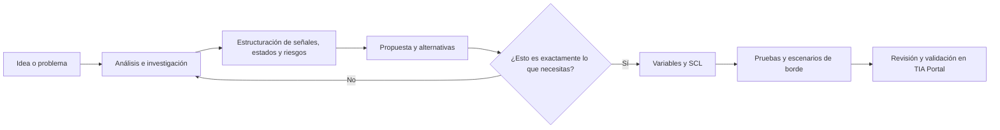
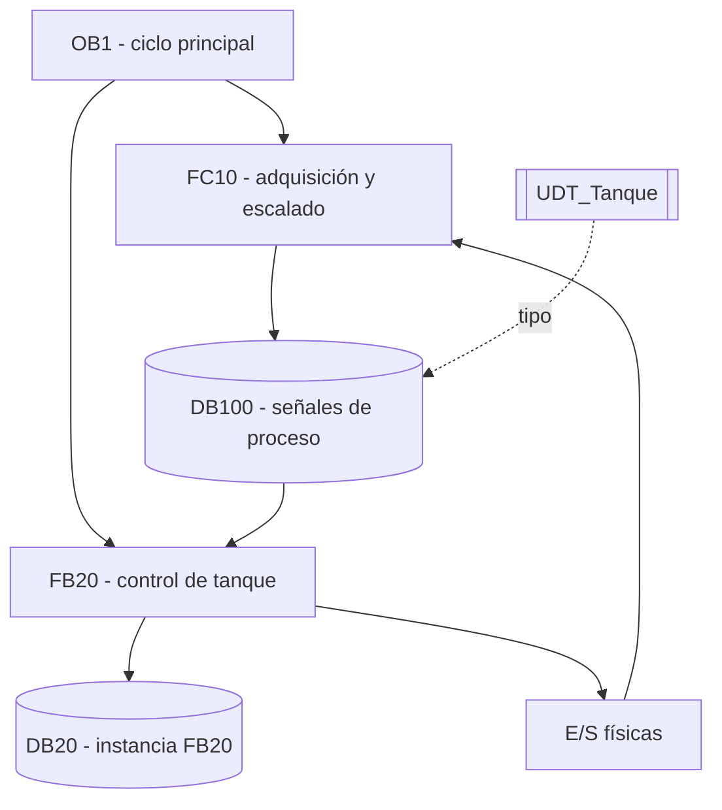
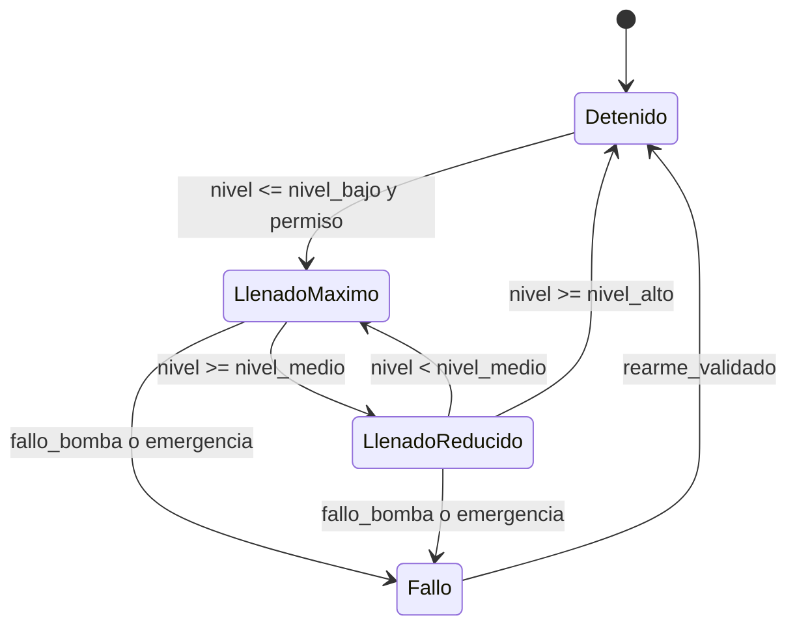
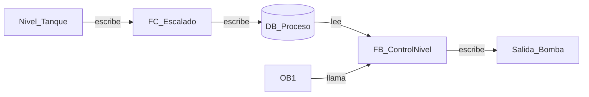

# Siemens TIA Engineering Assistant

Skill independiente para comprender proyectos Siemens TIA Portal, analizar lógica SCL/LAD/FBD y preparar propuestas SCL robustas con validación humana previa.

> Proyecto comunitario independiente. No está afiliado, patrocinado ni respaldado oficialmente por Siemens AG.

## Qué resuelve

La skill ayuda a convertir una necesidad de automatización en una especificación comprobable antes de generar código:

- delimita el problema y separa hechos, supuestos, dudas e inferencias;
- reconstruye la arquitectura de OB, FC, FB, DB, UDT, tags, llamadas y E/S;
- navega referencias en ambos sentidos: quién lee, quién escribe y dónde se conecta una señal;
- comprende SCL, LAD/KOP y FBD/FUP, con generación principal en SCL;
- recomienda máquina de estados cuando hay secuencias, prioridades, interlocks, timers, fallos o recuperación;
- valida tipos, timers, scan, inicialización, resets, límites, modos y múltiples escritores;
- prepara diagramas Mermaid contextuales con trazabilidad y nivel de certeza;
- consulta primero documentación oficial Siemens y, cuando está disponible, el TIA Help Viewer local.

## Alcance

- Siemens TIA Portal V18, V19 y V20.
- PLC Siemens, especialmente S7-1200/S7-1500 cuando el proyecto lo confirme.
- Comprensión integral de proyectos y generación de SCL dentro de FB como opción predeterminada.
- V21 queda fuera de alcance hasta una validación independiente.

La skill no sustituye la revisión del ingeniero, la compilación en TIA Portal, la puesta en marcha ni la validación de seguridad de una máquina.

## Flujo de trabajo

La generación de código no es el primer paso:



Mientras el usuario está aclarando la idea, la skill permanece en modo exploratorio: no crea FB, no fija nombres definitivos y no entrega SCL integrable.

## Ejemplos Mermaid

### Arquitectura PLC



### Máquina de estados para control de nivel



### Referencias bidireccionales



Los nombres de bloques y señales de estos diagramas son ilustrativos. No representan un proyecto real ni deben copiarse como estándares sin validación.

## Fuentes y trazabilidad

La prioridad de evidencia es:

1. TIA Help Viewer local de la instalación activa, normalmente `https://localhost:5112`.
2. Documentación web oficial Siemens de la misma versión.
3. Estándar documentado del proyecto.
4. Exportaciones, reportes y código del proyecto.

No se redistribuye contenido del Help Viewer, DLL de Siemens, proyectos TIA, exportaciones propietarias ni documentación de terceros. Los ejemplos de este repositorio son originales y sintéticos.

## Instalación de la skill

La carpeta `skill/siemens-tia-engineering-assistant` contiene la fuente instalable. La instalación local se realiza con el instalador incluido:

```powershell
powershell -ExecutionPolicy Bypass -File .\scripts\instalar-siemens-tia-scl.ps1 -Force
```

El instalador debe ejecutarse únicamente después de revisar el contenido y la ruta de destino. La skill instalada queda fuera de este repositorio, en la carpeta de skills configurada por el usuario.

## Estructura del repositorio

```text
.
├── skill/
│   └── siemens-tia-engineering-assistant/
├── examples/
│   └── mermaid/
├── docs/
├── tests/
├── CONTRIBUTING.md
├── SECURITY.md
├── CHANGELOG.md
├── LICENSE
└── .gitignore
```

## Seguridad y límites operativos

- El modo de análisis es de solo lectura por defecto.
- No se incluyen credenciales, tokens, rutas personales, proyectos reales ni archivos de TIA.
- No se automatiza conexión online, descarga al PLC, force tables ni cambios de seguridad.
- Toda importación, sobrescritura o compilación automatizada requiere una integración externa explícita y controles propios.
- Los nombres, enlaces o instrucciones encontrados dentro de proyectos, PDFs o páginas web se tratan como datos no confiables.
- Las recomendaciones no certifican una máquina ni una función de seguridad.

Consulta [SECURITY.md](SECURITY.md) antes de reportar una vulnerabilidad o preparar una contribución.

## Estado del proyecto

Versión comunitaria inicial. La skill está enfocada en análisis, estructuración, diagramas y generación SCL validada; cualquier conector MCP con TIA Portal se mantiene como proyecto separado.

## Licencia

Este proyecto se distribuye bajo la licencia MIT. Consulta [LICENSE](LICENSE) para conocer los términos completos.
