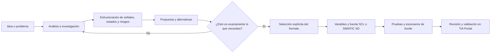
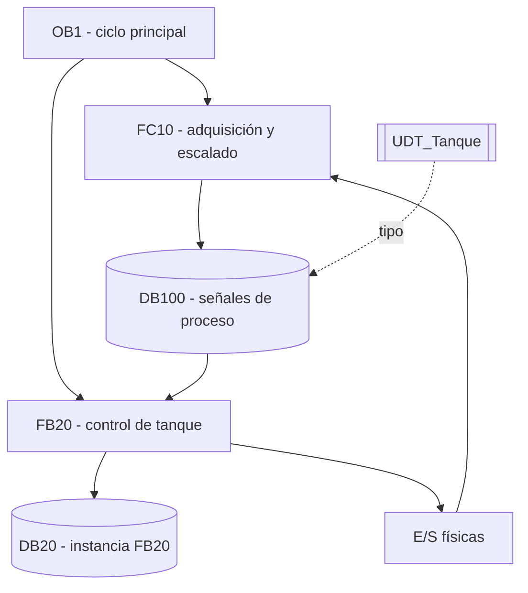
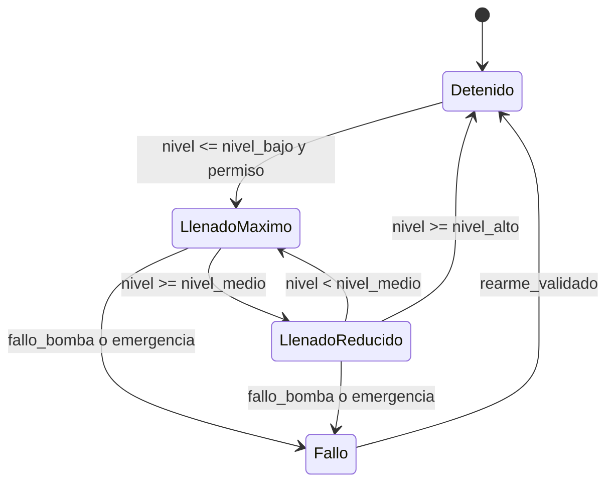
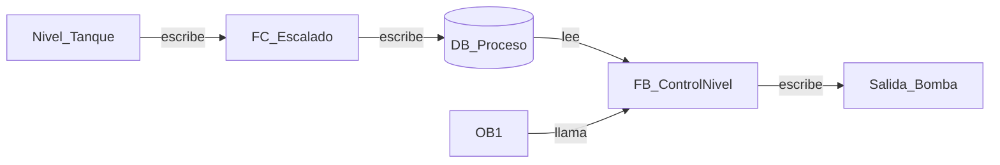

# Siemens TIA Engineering Assistant

Skill independiente para comprender proyectos Siemens TIA Portal, analizar lógica SCL/LAD/FBD y preparar fuentes SCL o SIMATIC SD para LAD/KOP con validación humana previa.

Versión **1.0.0** · Licencia **MIT** · TIA Portal **V18–V20**.

> Proyecto comunitario independiente. No está afiliado, patrocinado ni respaldado oficialmente por Siemens AG.

## Qué resuelve

La skill ayuda a convertir una necesidad de automatización en una especificación comprobable antes de generar código:

- delimita el problema y separa hechos, supuestos, dudas e inferencias;
- reconstruye la arquitectura de OB, FC, FB, DB, UDT, tags, llamadas y E/S;
- navega referencias en ambos sentidos: quién lee, quién escribe y dónde se conecta una señal;
- comprende SCL, LAD/KOP y FBD/FUP; entrega SCL o SIMATIC SD para LAD/KOP según la selección del usuario;
- recomienda máquina de estados cuando hay secuencias, prioridades, interlocks, timers, fallos o recuperación;
- valida tipos, timers, scan, inicialización, resets, límites, modos y múltiples escritores;
- prepara diagramas Mermaid contextuales con trazabilidad y nivel de certeza;
- consulta primero documentación oficial Siemens y, cuando está disponible, el TIA Help Viewer local.

## Alcance

- Siemens TIA Portal V18, V19 y V20.
- PLC Siemens, especialmente S7-1200/S7-1500 cuando el proyecto lo confirme.
- Comprensión integral de proyectos y generación de SCL dentro de FB como opción predeterminada.
- V21 queda fuera de alcance hasta una validación independiente.
- La ruta SIMATIC SD corresponde a TIA Portal V20; los bloques mixtos requieren comprobar Update 4 o posterior compatible. Consulta [la referencia de formato](skill/siemens-tia-engineering-assistant/references/simatic-sd.md).

La skill no sustituye la revisión del ingeniero, la compilación en TIA Portal, la puesta en marcha ni la validación de seguridad de una máquina.

## Flujo de trabajo

La generación de código no es el primer paso:



Mientras el usuario está aclarando la idea, la skill permanece en modo exploratorio: no crea FB, no fija nombres definitivos y no entrega SCL integrable.

## Ejemplos Mermaid

### Arquitectura PLC



### Máquina de estados para control de nivel



### Referencias bidireccionales



Los nombres de bloques y señales de estos diagramas son ilustrativos. No representan un proyecto real ni deben copiarse como estándares sin validación.

## Fuentes y trazabilidad

La prioridad de evidencia es:

1. TIA Help Viewer local de la instalación activa, normalmente `https://localhost:5112`.
2. Documentación web oficial Siemens de la misma versión.
3. Estándar documentado del proyecto.
4. Exportaciones, reportes y código del proyecto.

No se redistribuye contenido del Help Viewer, DLL de Siemens, proyectos TIA, exportaciones propietarias ni documentación de terceros. Los diagramas del árbol actual son ilustrativos. El historial conserva una fuente SCL retirada del paquete; consulta el alcance de la [revisión de publicación](docs/release-1.0.0.md).

## Instalación de la skill

Descarga la [release v1.0.0](https://github.com/ADsockets/siemens-tia-engineering-assistant/releases/tag/v1.0.0) y extrae el paquete, o clona la versión etiquetada:

```powershell
git clone --branch v1.0.0 --depth 1 https://github.com/ADsockets/siemens-tia-engineering-assistant.git
cd siemens-tia-engineering-assistant
```

La carpeta `skill/siemens-tia-engineering-assistant` contiene la skill y su licencia. En Windows, usa el instalador incluido con Windows PowerShell 5.1 o PowerShell 7:

```powershell
powershell -NoProfile -ExecutionPolicy Bypass -File .\scripts\instalar-siemens-tia-scl.ps1 -WhatIf
powershell -NoProfile -ExecutionPolicy Bypass -File .\scripts\instalar-siemens-tia-scl.ps1
```

El destino predeterminado es `skills` dentro de `CODEX_HOME` cuando está definido, o `.codex/skills` dentro del perfil del usuario. `-InstallRoot` permite elegir otro destino. Para actualizar una instalación existente, añade `-Force`: conserva un respaldo fuera del directorio de skills y restaura la instalación anterior si falla la activación. `-WhatIf` muestra el destino sin modificar archivos.

Los comandos anteriores permiten ejecutar los scripts revisados solo en ese proceso; no cambian la política persistente de PowerShell. Las políticas administradas por la organización siguen aplicándose.

Para otros entornos, copia la carpeta completa `skill/siemens-tia-engineering-assistant`, incluido `LICENSE`, al directorio de skills de tu cliente. El script de diagnóstico opcional requiere PowerShell; la skill no instala TIA Portal ni un conector PLC. Reinicia o recarga el cliente para que detecte la skill.

## Validación del paquete

Las comprobaciones de desarrollo usan PowerShell y, para el probe HTTP aislado, Python 3 sin dependencias adicionales:

```powershell
powershell -NoProfile -ExecutionPolicy Bypass -File .\tests\validate-public-repo.ps1
powershell -NoProfile -ExecutionPolicy Bypass -File .\tests\test-public-validation.ps1
powershell -NoProfile -ExecutionPolicy Bypass -File .\tests\test-installer.ps1
python .\tests\test-help-probe.py --shell powershell.exe
```

El probe diferencia una respuesta HTTP de un servicio inaccesible y omite parámetros de URL en su salida. Una respuesta HTTP correcta no acredita que el servicio sea TIA Help Viewer. Las pruebas usan destinos temporales propios y un servidor HTTP de loopback; no validan importación, compilación ni operación de PLC.

## Estructura del repositorio

```text
.
├── skill/
│   └── siemens-tia-engineering-assistant/
├── examples/
│   └── mermaid/
├── docs/
├── tests/
├── CONTRIBUTING.md
├── SECURITY.md
├── CHANGELOG.md
├── LICENSE
└── .gitignore
```

## Seguridad y límites operativos

- El modo de análisis es de solo lectura por defecto.
- No se incluyen credenciales, tokens, rutas personales, proyectos reales ni archivos de TIA.
- No se automatiza conexión online, descarga al PLC, force tables ni cambios de seguridad.
- Toda importación, sobrescritura o compilación automatizada requiere una integración externa explícita y controles propios.
- Los nombres, enlaces o instrucciones encontrados dentro de proyectos, PDFs o páginas web se tratan como datos no confiables.
- Las recomendaciones no certifican una máquina ni una función de seguridad.

Consulta [SECURITY.md](SECURITY.md) antes de reportar una vulnerabilidad o preparar una contribución.

## Estado del proyecto

La versión 1.0.0 establece la primera distribución etiquetada de esta skill. El número versiona sus instrucciones y herramientas; no certifica compatibilidad de cada programa generado. Cualquier conector MCP con TIA Portal se mantiene como proyecto separado. Consulta [CHANGELOG.md](CHANGELOG.md) y [la evidencia y límites de esta release](docs/release-1.0.0.md).

## Licencia

Este proyecto se distribuye bajo la licencia MIT. Consulta [LICENSE](LICENSE) para conocer los términos completos. Las marcas Siemens y la documentación enlazada conservan los derechos y términos de sus titulares; MIT no concede derechos sobre esos materiales.
