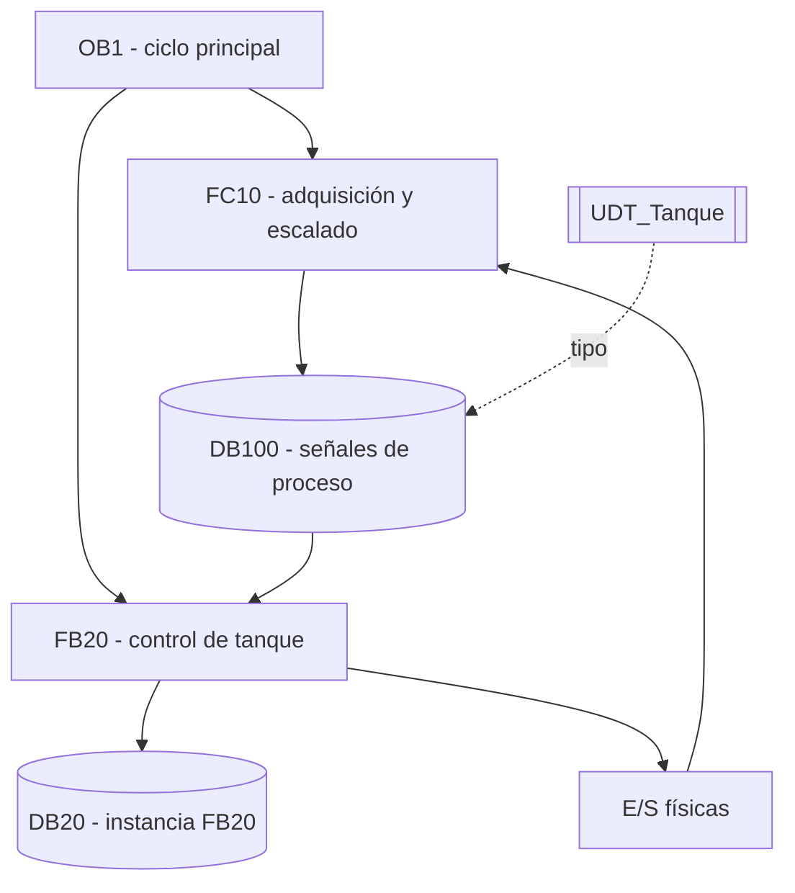

# Ejemplo: arquitectura PLC

Este ejemplo es sintético. Sirve para mostrar cómo representar llamadas, instancias, datos y E/S sin convertir el diagrama en una lista genérica de archivos.

## Lectura esperada

- `OB1` determina el orden de ejecución observado.
- `FC10` transforma señales de campo y actualiza datos de proceso.
- `FB20` contiene la lógica con memoria y usa `DB20` como instancia.
- `UDT_Tanque` describe la estructura de datos, no la secuencia de control.
- La relación con E/S debe confirmarse con tags y configuración hardware.
