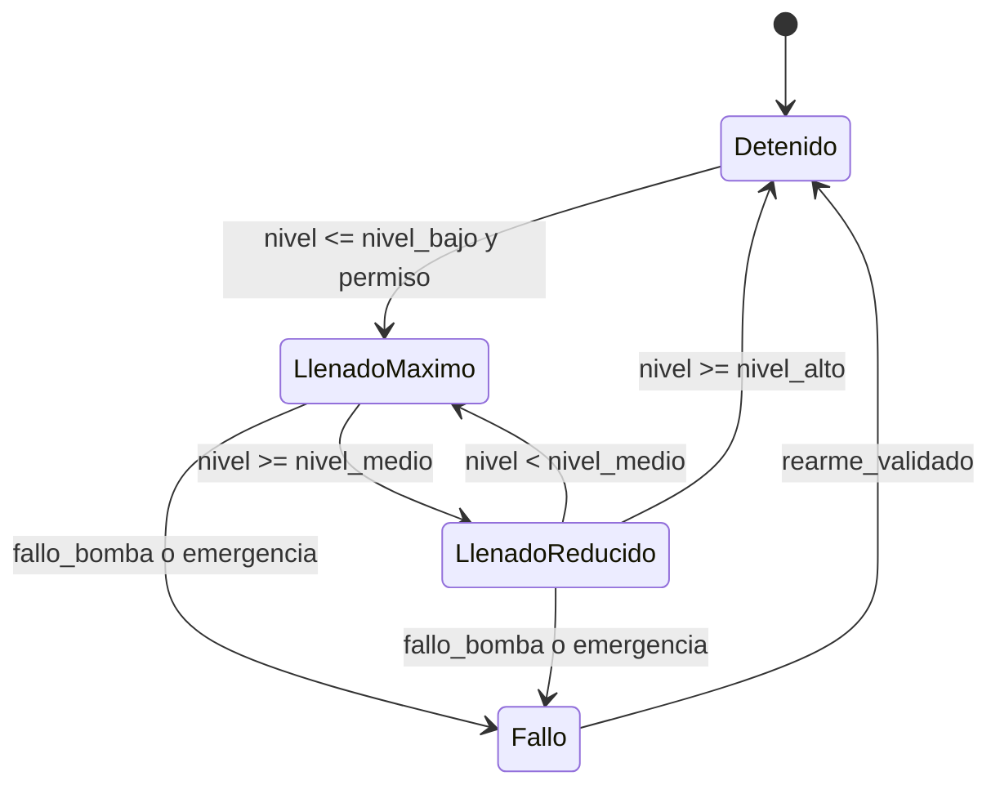

# Ejemplo: máquina de estados para nivel de tanque

Ejemplo ilustrativo de una secuencia con llenado rápido, llenado reducido, paro y fallo.

La skill debe confirmar histéresis, prioridad entre condiciones, comportamiento al primer ciclo, rearme y qué ocurre si varias señales cambian en el mismo scan.
