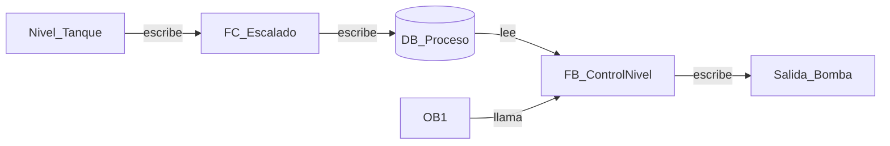

# Ejemplo: referencias bidireccionales

La dirección de cada relación debe provenir de una exportación, una referencia cruzada o una observación explícita. Si se infiere, debe marcarse como inferida.
